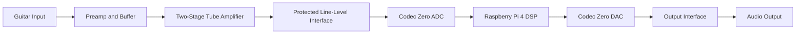
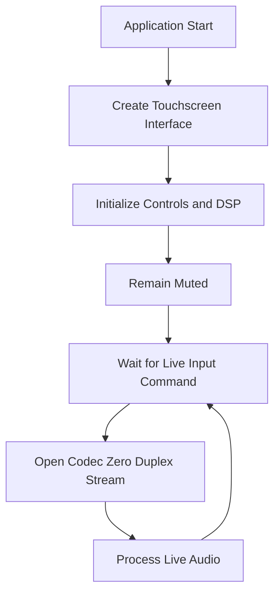
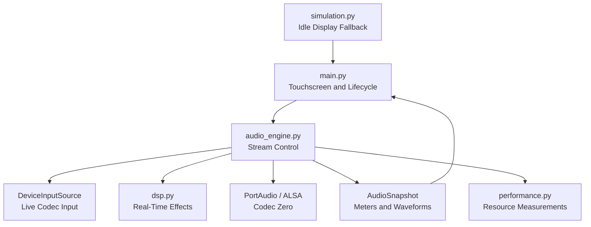
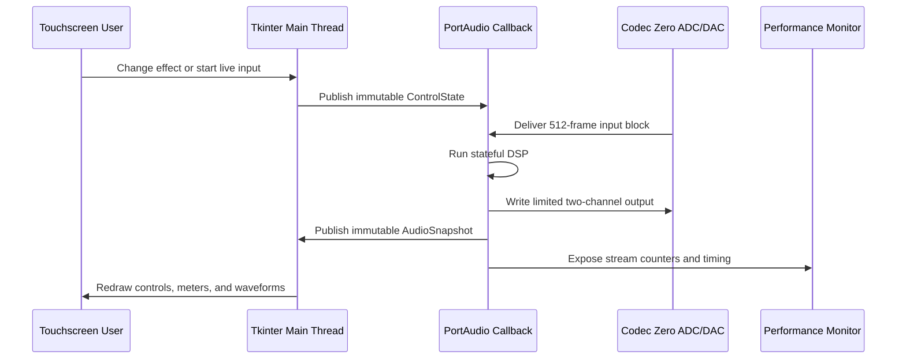
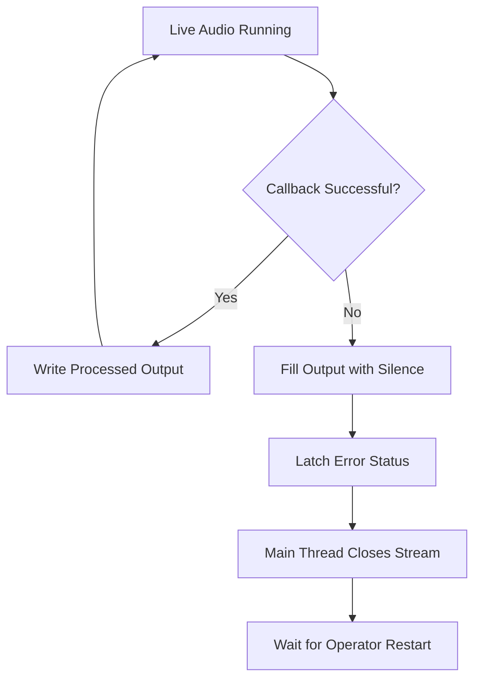

# Tube Screamer Guitar Amplifier Software Documentation

**Sponsor:** Dr. Logan Porter, ESET Department  
**Technical Advisor:** Dr. Lee Hudson  
**Team:** SKIXG Engineering  
**Revision:** 2.4  
**Revision Date:** September 8, 2026  
**Target:** Raspberry Pi 4 Model B, 2 GB with Raspberry Pi Codec Zero

## Table of Contents

1. Introduction
2. High-Level Logic Flow
3. System Documentation
4. Source Code Documentation
5. Engineering Requirements
6. User Documentation
7. Build and Installation
8. Test and Verification
9. Package and Import Reference
10. Appendix A - Development Verification Features
11. Appendix B - Open Engineering Items

## 1. Introduction

This is the software record for the SKIXG Tube Screamer Guitar Amplifier. The design pairs two Class A tube gain stages with a Raspberry Pi 4 Model B, Codec Zero, and a seven-inch touchscreen. The tubes supply the analog gain and harmonic response. The Pi is responsible for the controls, equalizer, digital effects, waveform display, status readings, and resource measurements.

Only live audio belongs to the final signal path. The guitar signal passes through the preamplifier and tube stages before it reaches the Codec Zero ADC. The Pi processes each captured block and sends the result back through the Codec Zero DAC. It never connects to B+, heater, plate, grid, mains, or speaker-level wiring, and it does not attempt to reproduce the tube stages in software.

Some controls in the present POC exist only because the amplifier hardware is not finished. File injection gives the team a repeatable test signal, while the Bias, Volume, and preset controls make demonstrations easier. Appendix A identifies these items so they are not mistaken for final product requirements or substitutes for the physical bias and master-volume controls.

The current integration baseline follows the team package dated September 8, 2026: Raspberry Pi 4 Model B with 2 GB RAM, one Raspberry Pi Codec Zero, the Waveshare 22676 display, mono Switchcraft input and output jacks, monophonic line-level audio, one enclosure, and one switched AC inlet. Older files in that package do not agree on every item. Section 3.9 lists those conflicts and leaves them open instead of silently choosing an answer for the hardware team.

## 2. High-Level Logic Flow

### 2.1 Product Signal Flow

<!-- pdf-figure: product-signal-flow -->


*Figure 1: Product audio and software signal flow.*

During normal operation, the software follows this sequence:

1. Raspberry Pi OS starts the graphical session and audio services.
2. The Tube Screamer application opens in full-screen mode.
3. The application initializes the neutral control state, DSP state, and muted audio state.
4. The operator starts live input from the touchscreen.
5. PortAudio opens the Codec Zero capture and playback device through ALSA.
6. The audio callback receives one 512-frame mono input block.
7. The DSP applies equalization, chorus, delay, echo, reverb, optional digital level scaling, and output limiting.
8. The processed mono block is copied to both Codec Zero output channels.
9. Meter and waveform data are published to the user interface.
10. The sequence repeats until the operator stops the stream, the application closes, or a fault occurs.

### 2.2 Application Startup Flow

<!-- pdf-figure: startup-flow -->


*Figure 2: Application startup and live-input sequence.*

The program opens with the stream stopped and the output muted. This avoids sending a startup transient while Raspberry Pi OS, the codec, or the amplifier is still settling. A successful **Start Live Input** command is the only path from the idle screen to active audio.

## 3. System Documentation

### 3.1 System Overview

The final Raspberry Pi build is expected to provide these functions:

- A touchscreen interface sized for the 1024 x 600 Waveshare display.
- Live mono audio capture from Codec Zero AUX IN.
- Real-time chorus, delay, echo, and reverb.
- A five-band equalizer centered at 100 Hz, 400 Hz, 1 kHz, 4 kHz, and 10 kHz.
- Live input and processed-output waveform displays.
- Signal level, RMS, dBFS, limiter, stream error, callback, and latency readings.
- Safe mute behavior when the audio source, callback, or device fails.
- CPU, RAM, temperature, clock, throttling, and audio-stream benchmark reports.
- Automatic full-screen startup through systemd on the Raspberry Pi.

### 3.2 System Architecture

<!-- pdf-figure: module-architecture -->


*Figure 3: Product software module architecture.*

The program runs as one local process. `main.py` manages the screen and application lifetime; `audio_engine.py` opens and closes the stream; `audio_sources.py` normalizes incoming device buffers; and `dsp.py` keeps the filter and delay state. `performance.py` records system and stream measurements during a benchmark. Before live input starts, `simulation.py` supplies display data only. It never sends audio to the output.

There is no web server and no network dependency. Control changes and status snapshots stay in process. ALSA exposes the Codec Zero device on Linux, and the Python code reaches its capture and playback buffers through PortAudio.

### 3.3 Hardware and Software Interfaces

#### Raspberry Pi 4

The Raspberry Pi 4 Model B runs the interface, DSP, and resource monitor. The selected board has 2 GB RAM and is locked in the September 8 Functional Specifications. For acceptance testing, the application and its child processes may use no more than 512 MiB combined RSS, and at least 512 MiB must remain available for Raspberry Pi OS and audio services.

#### Raspberry Pi Codec Zero

Codec Zero mounts on the Raspberry Pi 40-pin header. I2S carries the audio samples and I2C carries codec control. Raspberry Pi OS exposes the board as an ALSA device, which the application opens through PortAudio. Inside the DSP, blocks contain 512 mono `float32` samples at 96 kHz. This uses the board's maximum supported conversion rate.

The tube stage shall connect to AUX IN only through the reviewed line-level interface. AUX OUT is a line-level signal and shall connect to an approved output interface. Neither codec connection is a speaker-level connection.

#### Waveshare Touchscreen

HDMI carries video to the Waveshare display and USB carries touch events back to the Pi. Once Raspberry Pi OS recognizes the USB interface, Tkinter receives each touch as an ordinary pointer event. The application therefore needs no custom touch protocol. One vertical scroll region keeps every control reachable within the 1024 x 600 screen.

#### Tube Amplifier Interface

Tube bias stability, high voltage, input impedance, gain, grounding, and protection remain hardware responsibilities. No Raspberry Pi pin is allowed to connect directly to B+, heater, plate, grid, mains, or a speaker node. Bias and master volume are physical controls in the current scope, so the POC widgets with those names do not command the amplifier circuits.

#### Team Interface Baseline

| Interface or decision | Current integration baseline | Software treatment |
| --- | --- | --- |
| Computer | Raspberry Pi 4 Model B, 2 GB | Target platform locked in the Functional Specifications. |
| Converter | Raspberry Pi Codec Zero, one board for ADC and DAC | Open through ALSA/PortAudio; separate ADC and DAC blocks in older FBDs are logical functions, not separate purchased boards. |
| Input | Switchcraft 12A mono TS through preamp and two tube stages | Capture one protected line-level codec channel; microphone use requires separately approved conditioning. |
| Output | Codec Zero AUX OUT through optional physical master volume to Switchcraft #11 mono TS | Produce mono DSP and route one approved codec output channel; AUX OUT is not a speaker output. |
| Touchscreen | Waveshare 22676, 7-inch, 1024 x 600, HDMI video and USB touch | Full-screen Tkinter interface with vertical scrolling. |
| Bias | Manual physical potentiometers | No GPIO or software bias command is approved. |
| Tube bypass | Required by the project scope but absent from the present POC and undefined in current hardware | Remains an open system requirement; software shall not claim implementation. |
| Power | One 120 VAC inlet feeding the tube transformer and isolated 5 V digital supply | Software has no mains or B+ control. Shutdown does not discharge high-voltage storage. |

### 3.4 Audio Processing Architecture

<!-- pdf-figure: dsp-flow -->


*Figure 4: Real-time DSP order for each audio block.*

Every callback runs the stages in the order shown in Figure 4. Reordering them changes the sound and would require the response tests to be repeated. Filter histories and circular buffers remain in memory between callbacks, which lets echoes and reverb tails continue across block boundaries. Starting a new live session clears that state.

**Five-band equalizer.** Five peaking biquads provide the displayed bands. Each uses a nominal quality factor of 0.9, and each gain is limited to -12 dB through +12 dB. The coefficients are recalculated when a control changes, not on every audio block.

**Chorus.** A 40 ms circular buffer holds the recent signal. A 0.8 Hz sine wave moves the read point about 4 ms on either side of an 18 ms center delay. Linear interpolation between neighboring samples keeps that moving delay from stepping audibly.

**Delay and echo.** These are separate feedback lines: 280 ms with 0.34 feedback for Delay, and 420 ms with 0.48 feedback for Echo. Their touchscreen values set the amount mixed into the dry signal; they do not change the delay times.

**Reverb.** Three feedback branches, approximately 29.7 ms, 37.1 ms, and 41.1 ms long, form the reverb tail. Their unequal lengths reduce obvious repetition while using far less memory and CPU than convolution.

**Digital level and limiter.** In the POC, Volume multiplies the processed block by a value from zero to one. The product version should leave this multiplier at unity because master volume belongs to the physical output control, unless the team later approves a digital trim. The final DSP step counts values outside the allowed range and clips them to +/-0.95. That limiter contains the digital signal only; it cannot replace protection at the codec input or output.

### 3.5 Functionally Significant Data Structures

#### ControlState

`ControlState` is an immutable dataclass passed from the touchscreen layer to the audio engine. It contains six scalar control values and a five-element EQ tuple.

| Field | Type | Range | Meaning |
| --- | --- | --- | --- |
| `delay` | integer | 0 to 100 | Delay wet level |
| `reverb` | integer | 0 to 100 | Reverb wet level |
| `chorus` | integer | 0 to 100 | Chorus wet level |
| `echo` | integer | 0 to 100 | Echo wet level |
| `volume` | integer | 0 to 100 | POC digital output scale; unity in the product baseline |
| `bias` | integer | -50 to +50 | POC display control; not applied to live product audio |
| `eq` | five-integer tuple | -12 to +12 each | EQ gain in dB |

Moving any control creates a replacement state object. The callback reads that one object, so it cannot combine old values from some widgets with new values from others.

#### AudioSnapshot

`AudioSnapshot` is an immutable status record produced after a callback. It contains the source state, decimated input and output waveforms, peak and RMS levels, dBFS, limited-sample count, underruns, overruns, deadline misses, callback time, and nominal block latency. The UI reads the latest snapshot but never changes it.

#### Audio Block

An audio block is a one-dimensional NumPy `float32` array containing 512 mono samples. Values are normalized around the range -1.0 to +1.0. The engine copies the processed array into both columns of the two-channel output buffer.

#### DSP State

Each biquad stores two delay values. Chorus, delay, echo, and reverb store circular buffers and write positions. These objects belong to the audio engine and are changed only by the callback while a stream is active.

### 3.6 Thread and Device Communication

<!-- pdf-figure: thread-communication -->


*Figure 5: Communication between the user interface, callback, monitor, and codec.*

All Tkinter work stays on the main thread. PortAudio invokes the audio callback from its own thread, where the code reads the latest control state, processes one fixed block, fills the output buffer, and publishes a new snapshot. To keep callback time predictable, this path does not touch widgets, open files, write logs, launch processes, or wait on a blocking queue.

During a benchmark, the performance monitor wakes once per second. It gathers process measurements from `psutil`, copies the latest audio counters, and reads the Pi temperature and clock from Linux system files. None of those readings can alter the stream.

No project-specific communication protocol is needed. The threads exchange immutable Python records and NumPy arrays inside one process, while device audio follows the existing ALSA/PortAudio callback contract.

### 3.7 File and Report Formats

Normal amplifier operation does not read or write audio files. Engineering benchmarks produce two report files:

- **CSV benchmark report:** one row per second with elapsed time, process and child RSS, system memory, CPU, thread count, stream errors, callback time, output peak, limiter count, latency, temperature, clock, and throttling status.
- **JSON benchmark summary:** run configuration, platform, Python version, sample count, duration, aggregate metrics, individual acceptance results, and overall pass/fail.

If a Raspberry Pi-only reading is unavailable, the report stores null or marks it unavailable; it does not invent a substitute value. Voltage, current, and power are separate bench measurements made with a meter suited to the isolated supply or completed AC enclosure.

### 3.8 Error Handling

<!-- pdf-figure: fault-flow -->


*Figure 6: Software response to a live-audio fault.*

The main error conditions and responses are:

| Error condition | Detection | Software response |
| --- | --- | --- |
| Codec device missing | PortAudio stream open fails | Keep output muted and display the error |
| Input overflow | PortAudio status flag | Increment overrun counter and continue if the callback remains valid |
| Output underflow | PortAudio status flag | Increment underrun counter and continue if the callback remains valid |
| Callback deadline exceeded | Measured callback time exceeds block interval | Increment deadline-miss counter; invalidate performance run |
| Callback exception | Exception inside processing path | Fill output with zeroes, latch fault, close stream on main thread |
| Invalid DSP shape | Input is not a mono array | Reject the block and enter the callback fault path |
| Non-finite or excessive output | Final DSP stage | Count excessive samples and limit output to +/-0.95 |
| Application close | Window-close handler or system shutdown | Cancel UI timer, stop monitor, stop/close stream, release source, destroy window |
| Pi thermal or throttling issue | Linux thermal files and `vcgencmd` | Record failure in benchmark; operator stops test and corrects cooling/power |

Software mute is not the only protection required by the amplifier. The analog interface must independently limit voltage and remain safe if the Raspberry Pi is powered off, disconnected, or running faulty software.

### 3.9 Cross-Document Reconciliation

The September 8 team folder contains artifacts from multiple design revisions. The following differences must be corrected in the owning team documents before final release:

| Topic | Conflicting team records | Baseline used by this software document |
| --- | --- | --- |
| Raspberry Pi | Functional Specifications locks Pi 4/2 GB; the older budget and proposal list Pi 5. | Raspberry Pi 4 Model B, 2 GB. |
| ADC and DAC | Earlier FBDs show separate devices; the current parts list selects Codec Zero. | Codec Zero provides both converter functions. |
| Output stage | PDR/TAT diagrams show a power stage or voltage follower; current Functional Specifications states Codec Zero AUX OUT can drive the line output through an optional master-volume pot. | Line-level AUX OUT path; no internal loudspeaker or software-defined power stage. |
| Tube supply | Updated Scope and Test Plan use 50 V; current Functional Specifications specifies approximately 233 V B+ from a 300 VCT transformer. | Software states no operating B+ value. Hardware and test owners must approve one safe value and revise the test plan. |
| Sample rate | Proposal and scope state 24-bit/196 kHz; Codec Zero supports up to 24-bit/96 kHz. | 96 kHz DSP; proposal discrepancy remains open. |
| Bias | POC has a Bias widget; current scope states manual-only bias adjustment. | Physical-only bias; POC widget is not a hardware command. |
| Presets | POC has fixed preset buttons; project exclusions prohibit multiple saved presets. | No saved user presets; POC buttons are development-only pending final UI approval. |
| Bypass | Scope and proposal require tube bypass; current software and current parts list do not define it. | Not implemented and not claimed; team decision required. |

The software requirements below cover only functions that can be implemented without assuming resolution of these open hardware decisions.

## 4. Source Code Documentation

### 4.1 Source File Structure

```text
capstoneSoftwareDemo/
|-- main.py                         Touchscreen and application entry point
|-- audio_engine.py                 Live stream lifecycle and callback
|-- audio_sources.py                Live input adapter and development fixture
|-- dsp.py                          Stateful real-time effects
|-- performance.py                  Resource and stream benchmark recorder
|-- simulation.py                   Idle waveform display model
|-- requirements.txt                Supported Python dependency ranges
|-- requirements-lock.txt           Pinned Python dependency versions
|-- deploy/
|   `-- tube-screamer.service       Raspberry Pi systemd unit
|-- tests/                          Automated module tests
|-- docs/                           Design and integration documentation
`-- graphify-out/                   Generated source relationship graph
```

The product execution path is `main.py` to `AudioEngine`, `DeviceInputSource`, `RealtimeDSP`, and the Codec Zero stream. `PerformanceMonitor` is active only during an engineering benchmark. `simulation.py` supplies display-only values while the audio stream is idle.

### 4.2 main.py

`main.py` is the boundary between the operator and the audio system. It builds the Tkinter screen, turns widget values into `ControlState` records, and turns `AudioSnapshot` records into meters, status text, and waveforms. Hardware buffers never pass through Tkinter code.

Startup begins in `main()`, which parses the launch options, creates the Tk root, constructs `TubeScreamerDemo`, and enters the event loop. The constructor builds the controls, creates one `AudioEngine`, loads the neutral Clean POC setting, and schedules `_animate()`. That scheduled method publishes the current controls, services any latched audio fault, selects live or idle display data, redraws the screen, and schedules its next run.

The layout work is divided among `_build_ui()`, `_build_effects()`, `_build_eq()`, and `_build_presets()`. Stream control enters through `_toggle_live_input()`. `_controls()` takes one coherent snapshot of the widgets, `_draw_waveform()` renders normalized samples, and `_update_status()` formats the current measurements. User commands that can fail pass through `_audio_action()` so a device error can be shown without killing the interface. On exit, `close()` cancels the pending Tk callback before it shuts down the audio engine.

### 4.3 audio_engine.py

`audio_engine.py` owns the Codec Zero stream, the `RealtimeDSP` instance, callback counters, and the latest `AudioSnapshot`. Its `AudioStream` and `AudioBackend` protocols also provide the seams used by the automated tests. The UI calls lifecycle methods from the main thread; PortAudio reaches `_duplex_callback()` from its audio thread.

When `start_live_input()` is called, the engine closes any older stream, creates a `DeviceInputSource`, resets the DSP and counters, and requests a 96 kHz duplex stream with 512-frame blocks, one input channel, and two output channels. For each callback, `_process()` records PortAudio flags, reads the mono input, runs `RealtimeDSP.process()`, copies the result to both output channels, updates the meters, decimates waveform samples, and publishes a new snapshot.

`update_controls()` replaces the control record, while `get_status()` returns the most recent status record. Cleanup is deliberately kept out of the callback: `service()` notices a failed or stopped stream during the next UI cycle and closes it there. If processing raises an exception, the callback first fills the output buffer with zeroes, latches the fault, and publishes the error state. `shutdown()` uses the same ordered close path during application exit.

### 4.4 audio_sources.py

`audio_sources.py` gives the engine one source interface even though the repository contains both live capture and a development file fixture. `InputSource` defines that lifecycle, and `SourceSnapshot` carries its current name, state, position, duration, error, and underrun count. Only `DeviceInputSource` belongs to the product path.

PortAudio supplies `DeviceInputSource.read()` with `indata`. The method checks that a block is present, selects the first channel, converts it to `float32`, and returns the requested number of frames. `start()` and `stop()` change the source state, and `snapshot()` reports it without exposing mutable internals. A missing device block raises a runtime error; `AudioEngine` catches it and follows the same muted fault path used for other callback failures. Appendix A covers the file fixture.

### 4.5 dsp.py

All audible software processing is in `dsp.py`. `Biquad` implements one equalizer band, `DelayLine` provides a circular feedback delay, `Chorus` adds a modulated fractional read point, and `Reverb` combines three delay branches. `RealtimeDSP` owns those objects and fixes their processing order.

`RealtimeDSP.process()` accepts one mono block. It validates the array, updates EQ coefficients only when needed, works on a copy, runs each stage, counts samples outside the output limit, clips the result, and returns it. With flat EQ, zero effects, and unity digital level, the output follows the input; the tube sound has already been added in the analog section. `Biquad.configure()` calculates filter coefficients from gain, center frequency, sample rate, and Q. Every stage provides `reset()` so a new session cannot inherit an old tail or filter history.

The constructor rejects impossible sample rates and block sizes, and `process()` rejects anything other than a one-dimensional input. Control values are clamped before use. The final `np.clip()` call enforces the documented digital bound even if several boosted stages add together.

### 4.6 performance.py

`performance.py` records the evidence used to decide whether the program fits on the Raspberry Pi 4. `PerformanceSample` represents one CSV row. `PerformanceMonitor` owns the one-second sampling worker, the report paths, the collected samples, and the acceptance calculations. Small helper functions read RSS, Linux numeric files, throttling flags, means, and percentiles without leaking platform-specific details into the monitor loop.

`start()` prepares the report directory, primes the CPU counters, and launches the worker. `_run()` combines operating-system readings with the latest `AudioSnapshot` once per second. At the end of a run, `stop()` joins the worker, writes the CSV data, calculates the summary, and writes JSON. A vanished child process, denied process lookup, missing thermal file, or unavailable `vcgencmd` is recorded as zero or unavailable rather than crashing the benchmark. Missing data never counts as a passing measurement.

### 4.7 simulation.py

`simulation.py` keeps the inactive dashboard useful before a live stream starts. `simulate_signal()` creates a deterministic display waveform and applies inexpensive approximations of EQ, chorus, and delayed taps. The result is stored in `SimulationFrame` with its `SignalMetrics`; it shares `ControlState` with the live path so the controls still move the picture.

This signal stops at the display. It is never sent to Codec Zero, mixed with guitar audio, or used as evidence for voltage, latency, CPU, or audio-quality requirements. The function rejects fewer than two requested samples, and its tests check that every supported control combination produces finite, repeatable output.

### 4.8 deploy/tube-screamer.service

The systemd unit starts the application after the graphical and sound targets are available and restarts it after a process failure. Its checked-in values are bring-up defaults, not universal settings. `User`, `WorkingDirectory`, `DISPLAY`, `XAUTHORITY`, and `ExecStart` must be checked against the final Raspberry Pi image before the service is enabled.

## 5. Engineering Requirements

### 5.1 Functional Requirements

| ID | Requirement |
| --- | --- |
| SW-F-001 | The application shall start full-screen on Raspberry Pi OS at 1024 x 600. |
| SW-F-002 | The product dashboard shall expose delay, reverb, chorus, echo, and five EQ controls. |
| SW-F-003 | EQ bands shall be centered at 100 Hz, 400 Hz, 1 kHz, 4 kHz, and 10 kHz with -12 dB to +12 dB gain. |
| SW-F-004 | A control change shall affect subsequent live audio blocks without restarting the stream. |
| SW-F-005 | With all four effects disabled and all EQ bands at 0 dB, the DSP shall provide a clean unity-gain path. |
| SW-F-006 | The application shall capture mono audio from Codec Zero and output the processed signal on both DAC channels. |
| SW-F-007 | The DSP shall execute the documented processing order for every live block. |
| SW-F-008 | The dashboard shall display input and processed waveforms derived from the active live buffers. |
| SW-F-009 | System Status shall display real stream levels, timing, limiting, and error counters. |
| SW-F-010 | The software shall output silence after a callback, source, or device failure. |
| SW-F-011 | Normal shutdown shall stop the stream, workers, scheduled UI callback, and application window. |
| SW-F-012 | The benchmark shall write CSV samples and a JSON acceptance summary. |
| SW-F-013 | Benchmark data shall include RAM, CPU, temperature, throttling, callback timing, and stream errors when available. |

### 5.2 Performance Requirements

| ID | Requirement | Acceptance value |
| --- | --- | --- |
| SW-P-001 | Startup time | Dashboard visible within 5 seconds |
| SW-P-002 | Touch response | Updated value visible within 100 ms |
| SW-P-003 | Audio format | 96 kHz mono `float32` DSP |
| SW-P-004 | Audio block | 512 frames; 5.33 ms nominal interval |
| SW-P-005 | Stream stability | Zero underruns, overruns, and deadline misses in 30 minutes |
| SW-P-006 | Application memory | Peak combined RSS below 512 MiB |
| SW-P-007 | System memory margin | At least 512 MiB available |
| SW-P-008 | Memory stability | Growth below 50 MiB during stable test period |
| SW-P-009 | Average CPU | Below 50 percent of one Pi 4 core equivalent |
| SW-P-010 | CPU 95th percentile | Below 75 percent |
| SW-P-011 | Temperature | Below 80 C with no throttling flags |
| SW-P-012 | Output bound | Every sample within -0.95 to +0.95 |
| SW-P-013 | Callback deadline | Callback completes within 5.33 ms |
| SW-P-014 | End-to-end latency | Measured by loopback; design target below 25 ms |

The Codec Zero cannot meet the proposal statement of 196 kHz. The selected board and software operate at 96 kHz. The proposal requirement must be revised or the converter selection must change.

### 5.3 System Requirement Boundary

The following requirements belong to complete-amplifier verification rather than software-only acceptance. The software shall not report them as passed from normalized digital samples.

| Project requirement | Verification owner | Software responsibility |
| --- | --- | --- |
| At least 20 dB gain | Analog/system test | Keep the digital clean path at unity and report digital clipping. |
| 20 Hz to 20 kHz frequency response | Analog/system test | Process 96 kHz audio without adding an unintended bandwidth restriction. |
| +/-2 V line-level output | Codec/output-interface test | Keep normalized samples bounded; do not infer volts without calibration. |
| THD below 5 percent | Analog/system test | Provide a neutral DSP state; do not apply unrequested distortion. |
| ADC resolution and rate | Codec/system test | Request the approved ALSA format and record the actual negotiated format. |
| Tube bias and B+ safety | Hardware test | Make no direct electrical connection or control claim. |

## 6. User Documentation

### 6.1 Starting the Amplifier Interface

1. Verify that the Raspberry Pi, Codec Zero, touchscreen, and amplifier interfaces are installed and inspected.
2. Set the physical output level low before applying power.
3. Power the amplifier according to the approved hardware startup procedure.
4. Allow Raspberry Pi OS to boot. The systemd service should open the dashboard automatically.
5. Confirm that the dashboard shows an idle or stopped audio state and no device error.

### 6.2 Starting Live Audio

1. Connect the guitar to the approved input jack.
2. Connect Codec Zero AUX OUT through the approved output interface.
3. Select **Start Live Input**.
4. Confirm that the button changes to **Stop Live Input**.
5. Play the instrument at a low output level and inspect the raw and processed waveforms.
6. Open **System Status** and confirm that peak, RMS, dBFS, callback time, and stream-error values update.

If the application reports that the device cannot be opened, stop and verify the Codec Zero ALSA device and mixer configuration. Do not repeatedly raise the physical output level while diagnosing a missing signal.

### 6.3 Adjusting the Sound

Delay, reverb, chorus, and echo use a range from 0 to 100. A value of zero disables the audible contribution of that effect.

The five vertical EQ controls add or remove gain around their labeled center frequencies. Moving a control above zero boosts that band. Moving it below zero cuts that band. Large simultaneous boosts can trigger the final limiter; the Limited Samples reading indicates when this occurs.

The current POC also displays Bias, Volume, and factory preset controls. These controls support demonstrations but are not part of the approved product interface. Physical potentiometers provide tube-bias and master-volume adjustment. The project excludes saved user presets.

### 6.4 Reading the Display

The Raw Input Signal graph shows samples received from the codec before DSP. The Processed Output Signal graph shows the block after effects, volume, and limiting. The signal-flow panel identifies the analog and digital stages. System Status expands from the bottom and reports the active source, peak level, RMS, dBFS, limited samples, stream errors, callback time, and effective block latency.

The waveform is a short, decimated view of the latest block. It is useful for confirming activity, clipping shape, and visible effect changes. It is not an oscilloscope calibration measurement.

### 6.5 Stopping and Shutting Down

1. Select **Stop Live Input** before changing audio wiring.
2. Lower the physical output level.
3. Close the application only when engineering access is required.
4. Shut down Raspberry Pi OS before removing Pi power.
5. Follow the separate hardware shutdown procedure for tube high voltage and stored energy.

## 7. Build and Installation

### 7.1 Required Development and Target Tools

| Item | Version or baseline | Purpose |
| --- | --- | --- |
| Raspberry Pi OS | Current 64-bit Desktop image approved for the project | Target operating system |
| Python | Python 3 supported by the selected Pi OS image | Interpreter |
| Tkinter | Matching system Python package | Touchscreen GUI |
| ALSA utilities | Pi OS repository version | Device and mixer diagnostics |
| PortAudio | Pi OS repository version | Real-time device backend |
| NumPy | 2.5.2 pinned | Audio arrays and DSP operations |
| psutil | 7.2.2 pinned | CPU, RAM, and process measurements |
| sounddevice | 0.5.6 pinned | Python PortAudio interface |
| Git | Pi OS repository version | Source deployment and revision control |
| systemd | Included with Raspberry Pi OS | Automatic startup and restart |

The exact pinned versions in `requirements-lock.txt` are the configuration authority. If the lock changes, this table and Raspberry Pi verification record shall be updated in the same revision.

### 7.2 Raspberry Pi OS Packages

```bash
sudo apt update
sudo apt full-upgrade -y
sudo apt install -y \
  python3-tk python3-venv python3-pip \
  alsa-utils i2c-tools \
  libportaudio2 portaudio19-dev git
```

### 7.3 Application Installation

```bash
cd /home/pi
git clone <approved-project-repository-url> capstoneSoftwareDemo
cd capstoneSoftwareDemo
python3 -m venv .venv
source .venv/bin/activate
python -m pip install --upgrade pip
python -m pip install -r requirements-lock.txt
```

The repository URL is intentionally left as a deployment value because the final team repository location has not been recorded in this project copy.

### 7.4 Codec Zero Configuration

Power down the Pi before installing Codec Zero on the 40-pin header. After boot, verify device enumeration:

```bash
aplay -l
arecord -l
amixer scontrols
```

If the HAT EEPROM does not configure the codec, add the approved overlay to the active Raspberry Pi boot configuration and reboot:

```ini
dtoverlay=iqaudio-codec
```

Do not enable a second audio-HAT overlay. Record the final card/device identifiers and mixer values in the integration test record.

### 7.5 Isolated Codec Test

Complete these tests with isolated line-level equipment before connecting the tube circuit:

```bash
speaker-test -c 2 -t sine
arecord -f S32_LE -r 96000 -c 2 -d 5 capture.wav
aplay capture.wav
```

Confirm capture, playback, channel selection, gain, noise floor, and absence of clipping. The test signal shall remain inside the Codec Zero AUX input limit.

### 7.6 Manual Application Test

```bash
source .venv/bin/activate
python3 main.py --fullscreen
```

Start live input, change every effect, move every EQ band, test volume zero, open and close both information panels, and stop live input. Confirm that the application returns to silence without an exception.

### 7.7 Automated Test

```bash
source .venv/bin/activate
python -m unittest discover -s tests -v
```

All tests shall pass before code is loaded onto the target system.

### 7.8 systemd Installation

Update `deploy/tube-screamer.service` with the final Pi user and repository path, then install it:

```bash
sudo cp deploy/tube-screamer.service /etc/systemd/system/
sudo systemctl daemon-reload
sudo systemctl enable --now tube-screamer.service
systemctl status tube-screamer.service
```

Inspect startup logs with:

```bash
journalctl -u tube-screamer.service
```

### 7.9 Resource Acceptance Test

The product resource test uses live Codec Zero input:

```bash
python3 main.py \
  --benchmark-seconds 1800 \
  --benchmark-report reports/pi4-live.csv \
  --benchmark-scenario live
```

Run the test with all effects and EQ bands at their worst-case settings. Record Pi model, RAM, operating-system image, Python and dependency versions, codec settings, cooling, display brightness, ambient temperature, and external power-meter readings.

## 8. Test and Verification

### 8.1 Verification Matrix

| Test ID | Requirements | Procedure | Acceptance | Status |
| --- | --- | --- | --- | --- |
| SW-T-001 | SW-F-002, SW-F-003 | Inspect product controls, ranges, labels, and panels. | All approved controls present and reachable | Development pass; final UI profile pending |
| SW-T-002 | SW-F-004, SW-F-007, SW-P-012 | Process controlled blocks before and after control changes. | Effects change output; finite samples remain within +/-0.95 | Passed |
| SW-T-003 | SW-F-010, SW-F-011 | Inject callback and source faults. | Output becomes silence and resources close | Passed |
| SW-T-004 | SW-F-012, SW-F-013 | Generate benchmark report from controlled snapshots. | CSV and JSON contain required values | Passed |
| SW-T-005 | SW-F-001, SW-P-001, SW-P-002 | Boot target and operate dashboard. | Visible within 5 s; display response below 100 ms | Not run on Pi |
| SW-T-006 | SW-F-006, SW-F-008, SW-F-009, SW-P-003, SW-P-004 | Capture isolated line input and monitor output/status. | Stable 96 kHz, 512-frame operation with real waveforms | Not run on Pi |
| SW-T-007 | SW-P-005, SW-P-006, SW-P-007, SW-P-008, SW-P-009, SW-P-010, SW-P-011, SW-P-013 | Run 30-minute worst-case live benchmark. | Every resource and stream criterion passes | Not run on Pi |
| SW-T-008 | SW-P-014 | Loop DAC output to ADC and measure sample offset. | Latency recorded; target below 25 ms | Not run |
| SW-T-009 | SW-F-011 | Stop service, close application, and shut down Pi. | No stream, worker, or callback remains active | Not run on Pi |
| SW-T-010 | SW-F-005 | Process a known block with effects disabled, EQ flat, and digital level at unity. | Output matches input within floating-point tolerance | Passed |

### 8.2 Team Test Plan Cross-Reference

| Team test | Software evidence or required method |
| --- | --- |
| RP-01 Clean Signal | SW-T-010 verifies a neutral block is unchanged; final validation compares Codec Zero analog input and output at approved levels. |
| RP-02 Digital Effect | SW-T-002 verifies that each effect changes output and remains finite. |
| RP-03 Touchscreen Control | SW-T-001 verifies controls and ranges; final validation is performed on the 1024 x 600 display. |
| RP-04 Multiple Effect | SW-T-007 runs all effects and EQ under the 30-minute resource and stream acceptance test. |
| RP-05 Digital Effects Output | Inspect processed software samples or I2S with suitable digital equipment; an oscilloscope measures the analog DAC output, not numeric Pi samples. |
| AD-01 through AD-05 | Use calibrated analog measurements at AUX IN/AUX OUT and software capture comparison. Do not treat ADC output as a DC analog signal. |
| NT-03 and NT-04 | Measure codec and full-system noise with effects neutral and then active, using a defined bandwidth, load, gain, and input termination. |

### 8.3 Current Software Evidence

The repository contains 22 automated tests covering DSP output, limiter behavior, state continuity, source lifecycle, callback fault mute, benchmark output, and idle simulation. The suite passes in the current development environment. These tests establish software behavior but do not replace Codec Zero, Raspberry Pi thermal, live latency, or amplifier safety testing.

An earlier 48 kHz development-system run measured approximately 184 MiB peak combined RSS, 3.4 percent average normalized CPU, 1.1 ms callback processing time, and no reported stream errors. Those measurements do not qualify the 96 kHz baseline. Raspberry Pi acceptance remains open until the 30-minute live test is recorded at 96 kHz.

### 8.4 Code Quality Checks

```bash
ruff check .
bandit -q -r main.py audio_engine.py audio_sources.py dsp.py performance.py simulation.py
vulture main.py audio_engine.py audio_sources.py dsp.py performance.py simulation.py tests
pip-audit -r requirements-lock.txt
graphify update . --force
```

These checks found no actionable issues in the recorded baseline. Run them again whenever source code or a pinned dependency changes.

## 9. Package and Import Reference

### 9.1 Python Packages

| Package | Pinned version | Use |
| --- | --- | --- |
| `numpy` | See `requirements-lock.txt` | `float32` blocks, arrays, interpolation, RMS, limiter |
| `sounddevice` | See `requirements-lock.txt` | PortAudio duplex stream and callback |
| `psutil` | See `requirements-lock.txt` | Process CPU, RAM, child processes, threads, system memory |
| `cffi` | Transitive dependency | Native interface used by sounddevice |
| `pycparser` | Transitive dependency | C parser used by cffi |

Tkinter, `argparse`, `csv`, `json`, `math`, `os`, `pathlib`, `platform`, `statistics`, `subprocess`, `threading`, `time`, `dataclasses`, and `typing` are supplied by Python or Raspberry Pi OS.

### 9.2 Imports by Product Module

**main.py** imports Tkinter, command-line and dataclass utilities, `AudioEngine`, `PerformanceMonitor`, and shared simulation state.

**audio_engine.py** imports timing and numeric utilities, `DeviceInputSource`, `RealtimeDSP`, and `ControlState`. `sounddevice` is imported only when the engine first requires an audio backend, allowing non-audio tests to inject a fake backend.

**audio_sources.py** imports NumPy and source-state definitions. Its product path uses `DeviceInputSource`; development-only file imports are described in Appendix A.

**dsp.py** imports `math`, NumPy, and `ControlState`.

**performance.py** imports CSV/JSON, operating-system and threading utilities, `psutil`, and `AudioEngine`.

**simulation.py** imports only `math` and `dataclasses`.

## 10. Appendix A - Development Verification Features

The repository contains `FileInputSource` and touchscreen file controls so the team can feed a repeatable recording through the callback and hear DSP changes before Codec Zero and the tube interface are connected. This is test equipment implemented in software. It is not an amplifier input mode, product function, customer use case, or functional requirement.

The adapter supports uncompressed PCM WAV through Python and MP3/M4A through FFmpeg. It decodes into a bounded 16-block queue and supplies blocks to the same `RealtimeDSP` used by live input. Its purpose is to provide deterministic demonstrations, regression tests, and resource stress runs during development.

The POC also includes factory preset buttons, a digital Bias control, and a digital Volume control. The latest project scope assigns bias and master volume to physical potentiometers and excludes multiple saved presets. Therefore, the product deployment profile shall hide these POC controls unless the team formally changes the scope. The live DSP does not apply digital bias or extra tube shaping; its neutral configuration provides the clean path required by test RP-01.

Before the final product release, the deployed interface shall hide or remove file-selection controls. FFmpeg is not required for normal live amplifier operation. Development tests for file decoding remain valid repository tests because they verify the external test adapter, not the product signal path.

## 11. Appendix B - Open Engineering Items

| ID | Open item | Required action |
| --- | --- | --- |
| SW-R-001 | Codec Zero supports 96 kHz rather than the proposal's 192/196 kHz statement. | Approve the 96 kHz requirement or select another codec. |
| SW-R-002 | Protected tube-to-codec interface is not characterized. | Approve schematic and measure maximum level, impedance, DC blocking, protection, and noise. |
| SW-R-003 | Physical bias control is undefined. | Keep software disconnected until isolated hardware limits and safe state are approved. |
| SW-R-004 | Final ALSA identifiers and mixer settings are unknown. | Record and validate them during Pi bring-up. |
| SW-R-005 | Pi 4 CPU, RAM, and temperature acceptance is not complete. | Run and archive the 30-minute worst-case live benchmark. |
| SW-R-006 | End-to-end latency is not measured. | Perform DAC-to-ADC loopback and tune block configuration if required. |
| SW-R-007 | Development-only file, preset, Bias, and Volume controls remain visible in the POC. | Hide them in the final product deployment profile unless scope changes are approved. |
| SW-R-008 | Functional Specifications locks Raspberry Pi 4/2 GB while the older proposal and budget list Raspberry Pi 5. | Update the proposal, budget, FBD labels, and power calculations to Raspberry Pi 4 Model B, 2 GB. |
| SW-R-009 | Tube bypass is required in the scope but has no current software control or approved hardware interface. | Define a fail-safe hardware bypass and control interface, or formally remove the requirement. |
| SW-R-010 | Current FBDs show separate ADC/DAC and inconsistent output stages. | Revise the team FBD to show Codec Zero ADC/DAC and the approved line-level output path. |
| SW-R-011 | Scope/Test Plan tube voltages conflict with the current high-voltage design. | Hardware and test owners shall establish the approved operating values and safe test procedure. |
| SW-R-012 | Final mono Codec Zero input/output channels are not selected. | Record channel, mixer, and connector assignments during isolated codec bring-up. |

The software is ready for final amplifier integration only after the protected analog interface is approved, Codec Zero live capture and playback are validated, all Raspberry Pi acceptance tests pass, and the development-only file controls are excluded from the deployed product interface.
