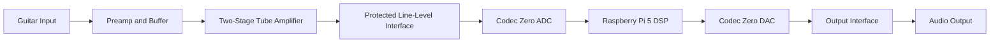
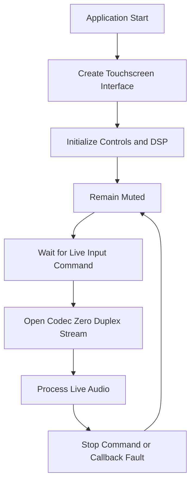
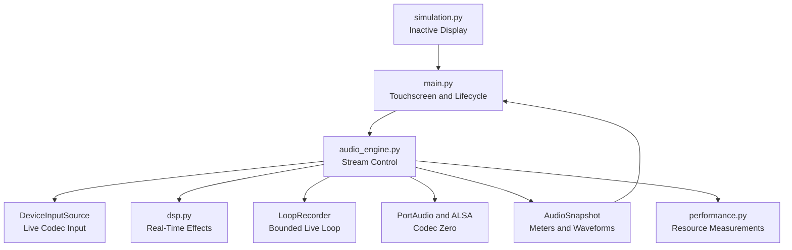
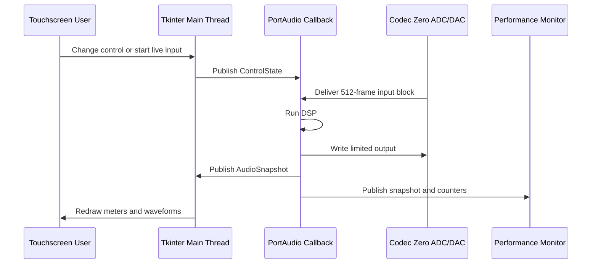
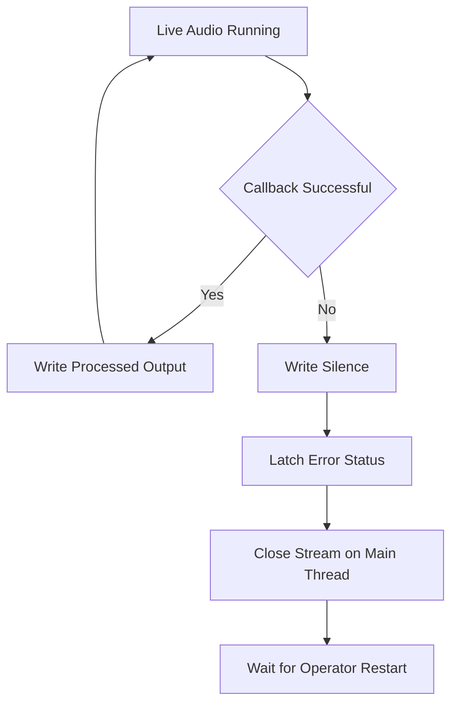

# Tube Screamer Guitar Amplifier Software Documentation

**Sponsor:** Dr. Logan Porter, ESET Department  
**Technical Advisor:** Dr. Lee Hudson  
**Team:** SKIXG Engineering  
**Revision:** 2.8  
**Revision Date:** September 8, 2026  
**Target:** Raspberry Pi 5, 8 GB with Raspberry Pi Codec Zero

## Table of Contents

1. Introduction
2. Logic Flow
3. System Documentation
4. Source Code Documentation
5. Build and Use Information

## 1. Introduction

This document explains the software designed for the SKIXG Tube Screamer Guitar Amplifier. The amplifier combines two Class A tube gain stages with a Raspberry Pi 5, Raspberry Pi Codec Zero, and a seven-inch touchscreen. The analog stages provide the amplifier gain and tube response. The Raspberry Pi handles the touchscreen, digital effects, equalization, waveform display, stream status, and resource monitoring.

The product processes live guitar audio. The signal passes through the preamplifier and tube stages before it reaches the Codec Zero ADC. The Raspberry Pi processes each captured block and returns it through the Codec Zero DAC. The software has no direct electrical connection to B+, heater, plate, grid, mains, or speaker-level wiring.

This revision documents the intended product design and the current implementation of the live audio path. Hardware measurements and Raspberry Pi acceptance results remain pending until the Codec Zero and protected analog interfaces are assembled.

## 2. Logic Flow

### 2.1 Product Signal Flow

<!-- pdf-figure: product-signal-flow -->


*Figure 1: Product audio and software signal flow.*

The software begins at the Codec Zero ADC and ends at the Codec Zero DAC. It does not replace the preamplifier, tube stages, or analog protection circuits.

### 2.2 Application Logic Flow

<!-- pdf-figure: startup-flow -->


*Figure 2: Application startup and live-input sequence.*

During normal operation:

1. Raspberry Pi OS starts the graphical session and audio services.
2. The application opens the touchscreen interface in full-screen mode.
3. The DSP state and audio counters are initialized while the output remains muted.
4. The operator starts live input from the touchscreen.
5. PortAudio opens the Codec Zero capture and playback device through ALSA.
6. The callback receives one 512-frame mono block.
7. The DSP applies equalization, chorus, delay, echo, reverb, and output limiting.
8. The processed block is copied to both output channels.
9. The interface receives updated waveform, level, timing, and error data.
10. Processing continues until the operator stops the stream, the application closes, or a fault occurs.

The program does not open an audio stream during startup. Live audio begins only after **Start Live Input** succeeds.

## 3. System Documentation

### 3.1 System Overview

The software provides the following functions:

- Full-screen touchscreen controls sized for the 1024 x 600 Waveshare display.
- Live mono capture from Codec Zero AUX IN.
- Real-time delay, reverb, chorus, echo, distortion, phaser, and flanger.
- A 30-second maximum live looper with separate capture and close-loop controls.
- Five-band equalization at 100 Hz, 400 Hz, 1 kHz, 4 kHz, and 10 kHz.
- Raw-input and processed-output waveform displays.
- Peak, RMS, dBFS, limiter, callback-time, latency, and stream-error readings.
- Muted output when the source, callback, or audio device fails.
- CPU, RAM, temperature, clock, throttling, and stream benchmark records.
- Automatic startup through systemd on Raspberry Pi OS.

The current DSP format is 96 kHz mono `float32` with 512 frames per block. This gives a nominal block interval of 5.33 ms. The output limiter holds samples between -0.95 and +0.95. Raspberry Pi acceptance requires less than 4,000 MiB combined process memory, at least 2,048 MiB available system memory, average process CPU below 50 percent of one Pi 5 core, 95th-percentile process CPU below 75 percent, and no thermal throttling during the 30-minute live test.

### 3.2 System Architecture

<!-- pdf-figure: module-architecture -->


*Figure 3: Product software module architecture.*

The application runs as one local Python process. `main.py` owns the screen and application lifetime. `audio_engine.py` controls the duplex stream and coordinates live input with the DSP. `audio_sources.py` converts the incoming device buffer to the mono source format. `dsp.py` owns the filter and delay state. `performance.py` records resource and stream data during a benchmark. `simulation.py` supplies display data while the stream is inactive; it does not produce output audio.

The design does not use a web server, cloud service, or network connection. ALSA exposes Codec Zero on Raspberry Pi OS, and PortAudio supplies the callback used by the Python application.

### 3.3 Software Interfaces

The amplifier does not expose an HTTP, REST, or external programming API. Its software boundaries are local Python interfaces:

| Interface | Data exchanged | Direction |
| --- | --- | --- |
| Touchscreen to `AudioEngine` | Immutable `ControlState` | User interface to audio engine |
| `AudioEngine` to touchscreen | Immutable `AudioSnapshot` | Audio engine to user interface |
| PortAudio to callback | 512-frame input array and status flags | Codec to audio engine |
| Callback to PortAudio | Two-channel `float32` output array | Audio engine to codec |
| `AudioEngine` to `RealtimeDSP` | Mono block and current controls | Stream layer to DSP |
| `PerformanceMonitor` | Process data and latest audio counters | Application to CSV and JSON reports |

No project-specific packet format or network protocol is used. The program exchanges Python records and NumPy arrays inside one process.

#### Engineering Report Files

The application writes two resource-benchmark files. The CSV file is UTF-8, comma-delimited text with one header row and one measurement row per sampling interval. Its columns record elapsed time, process and child memory, available system memory, normalized process CPU, system CPU, thread count, underruns, overruns, deadline misses, callback time, output peak, limiter count, effective latency, CPU temperature, CPU clock, and throttling status.

The JSON summary is UTF-8 text. Its top-level keys are `configuration`, `platform`, `python_version`, `power_measurement`, `sample_count`, `duration_seconds`, `metrics`, `acceptance`, and `passed`. `metrics` contains the calculated averages, peaks, percentiles, and memory growth. `acceptance` contains one Boolean or null result for each resource limit. A missing Raspberry Pi-only measurement is stored as null or unavailable and cannot create a passing result.

Control settings remain in memory while the program runs. The product does not define a saved-preset file or a network message format.

### 3.4 Hardware Interfaces

#### Raspberry Pi 5

The selected controller is a Raspberry Pi 5 with 8 GB RAM. It runs the interface, DSP, and performance monitor. The application and its child processes are limited to 4,000 MiB combined RSS during acceptance testing, and at least 2,048 MiB must remain available to Raspberry Pi OS and the audio stack.

#### Raspberry Pi Codec Zero

Codec Zero mounts on the Raspberry Pi 40-pin header. I2S carries digital audio and I2C carries codec control. Raspberry Pi OS exposes the board through ALSA, and the application opens it through PortAudio. The board and current software operate at 24-bit/96 kHz.

The tube stage must connect to AUX IN through a reviewed, protected line-level interface. AUX OUT must connect to an approved line-level output interface. Neither connection is speaker level.

#### Waveshare Touchscreen

The Waveshare 22676 display receives 1024 x 600 video over HDMI and sends touch events over USB. Raspberry Pi OS presents touch input as pointer events, which Tkinter handles without a project-specific touch driver. Fixed Home, Effects, and EQ/Waveforms pages keep every product control visible without scrolling.

#### Tube Amplifier

Tube bias, high voltage, input impedance, grounding, gain, and analog protection remain hardware responsibilities. The current software does not control tube bias or the physical master-volume circuit. It also does not implement tube bypass because no approved hardware control interface has been defined.

### 3.5 Audio Processing

<!-- pdf-figure: dsp-flow -->


*Figure 4: Processing order for each live audio block.*

Each callback runs the stages in the order shown in Figure 4. Filter histories and circular buffers stay in memory between callbacks so the equalizer response, echoes, and reverb tails continue across block boundaries. Starting a new live session resets that state.

**Equalizer.** Five peaking biquad filters provide the displayed bands. Each band uses a nominal Q of 0.9 and accepts gain from -12 dB through +12 dB. Coefficients change only when an EQ control changes.

**Distortion.** A normalized hyperbolic tangent transfer curve adds harmonic content. The pad controls wet mix, while Drive controls the curve gain.

**Chorus.** The chorus uses a 40 ms circular buffer. A sine wave moves the read point approximately 4 ms around an 18 ms center delay. The Rate parameter sets the modulation speed, and linear interpolation prevents abrupt delay steps.

**Phaser and flanger.** The phaser uses four swept all-pass stages. The flanger uses a feedback delay swept between approximately 1 ms and 7 ms. Their secondary parameters control phaser rate and flanger depth.

**Delay and echo.** Delay provides an adjustable interval from 80 ms through 700 ms with 0.34 feedback. Echo uses a 420 ms line with adjustable feedback from zero through 80 percent. Their pads control wet mix.

**Reverb.** Three feedback lines of approximately 29.7 ms, 37.1 ms, and 41.1 ms produce the reverb tail. Decay changes their feedback from 10 through 95 percent.

**Looper.** The left half begins capturing mono input before DSP. The right half closes the recording and starts repetition. During repetition, the loop replaces the current input block before entering the effects chain. Selecting the left half again stops and clears the loop. Capture is limited to 30 seconds, approximately 11 MiB at 96 kHz `float32`.

**Digital output level.** The current implementation multiplies the processed block by the touchscreen Volume value from zero to unity. The physical output control remains responsible for the amplifier's final output level.

**Limiter.** The final stage counts samples outside the accepted range and clips the block to +/-0.95. This protects the digital range but does not replace analog protection.

### 3.6 Data Structures

#### ControlState

`ControlState` is an immutable record passed from the touchscreen to the audio engine.

| Field | Type | Range | Use |
| --- | --- | --- | --- |
| `delay` | integer | 0 to 100 | Delay wet level |
| `reverb` | integer | 0 to 100 | Reverb wet level |
| `chorus` | integer | 0 to 100 | Chorus wet level |
| `echo` | integer | 0 to 100 | Echo wet level |
| `distortion` | integer | 0 to 100 | Distortion wet level |
| `phaser` | integer | 0 to 100 | Phaser wet level |
| `flanger` | integer | 0 to 100 | Flanger wet level |
| `volume` | integer | 0 to 100 | Digital output multiplier used by the current implementation |
| `bias` | integer | -50 to +50 | Inactive-display shaping only; not applied to live audio |
| `eq` | five-integer tuple | -12 to +12 each | Equalizer gain in dB |
| Effect parameters | seven integers | Effect-specific | Delay time, reverb decay, chorus rate, echo feedback, distortion drive, phaser rate, and flanger depth |

The complete record is replaced when a control changes. The callback therefore reads one consistent set of values.

#### AudioSnapshot

`AudioSnapshot` is an immutable status record published after a callback. It contains source state, decimated input and output waveforms, peak and RMS levels, dBFS, limiter count, underruns, overruns, deadline misses, callback time, and nominal block latency. The touchscreen reads the latest snapshot but does not modify it.

#### Audio Block and DSP State

An audio block is a one-dimensional NumPy `float32` array containing 512 mono samples normalized around -1.0 to +1.0. The engine copies the processed block into both output columns. Each biquad stores two delay values, and each time-based effect stores a circular buffer and write position. Only the callback changes this DSP state while a stream is active.

### 3.7 Thread and Device Communication

<!-- pdf-figure: thread-communication -->


*Figure 5: Communication between the interface, callback, monitor, and codec.*

Tkinter remains on the main thread because widget operations are not thread-safe. PortAudio invokes the audio callback from its own thread. The callback reads the latest controls, processes one block, fills the output buffer, and publishes a new snapshot. It does not call Tkinter, open files, write logs, start processes, or wait on a blocking queue.

During a benchmark, the performance monitor wakes once per second. It reads process measurements, Raspberry Pi temperature and clock data, and the latest audio counters. It never changes the audio stream.

### 3.8 Error Handling

<!-- pdf-figure: fault-flow -->


*Figure 6: Response to a live-audio fault.*

| Condition | Detection | Response |
| --- | --- | --- |
| Codec unavailable | PortAudio cannot open stream | Keep output muted and display the error |
| Input overflow | PortAudio status flag | Count the overrun and continue if the callback remains valid |
| Output underflow | PortAudio status flag | Count the underrun and continue if the callback remains valid |
| Callback exceeds block interval | Measured callback time | Count a deadline miss and fail the performance run |
| Processing exception | Exception in callback path | Write zeroes, latch the fault, and close the stream on the main thread |
| Invalid input shape | Input is not a mono array | Reject the block and enter the callback fault path |
| Excessive output | Final DSP stage | Count affected samples and limit output to +/-0.95 |
| Application shutdown | Window close or OS shutdown | Cancel UI timer, stop monitor, close stream, and destroy the window |

Software mute is not the amplifier's only safety control. The protected analog interface must remain safe if the Raspberry Pi is off, disconnected, or running faulty software.

### 3.9 Current Integration Status

The interface, DSP, live-stream architecture, error handling, waveform display, resource monitor, and unit tests are implemented in the current repository. The live Codec Zero path is designed but has not yet completed target-hardware acceptance.

The following work remains for Raspberry Pi integration:

- Approve and characterize the protected tube-to-codec interface.
- Record the final ALSA card, device, channel, and mixer settings.
- Confirm live capture and playback through Codec Zero at 96 kHz.
- Measure end-to-end latency with a DAC-to-ADC loopback.
- Run the 30-minute CPU, RAM, temperature, throttling, and stream-stability test on the Raspberry Pi 5.
- Define an approved hardware interface for tube bypass or remove that requirement from the project scope.

## 4. Source Code Documentation

### 4.1 Source File Structure

```text
capstoneSoftwareDemo/
|-- main.py                       Application entry point
|-- touchscreen_ui.py             Fixed-size touchscreen and development windows
|-- audio_engine.py               Duplex stream lifecycle and callback
|-- audio_sources.py              Live input adapter
|-- dsp.py                        Stateful real-time effects
|-- performance.py                Resource and stream benchmark recorder
|-- simulation.py                 Inactive waveform display model
|-- requirements.txt              Supported dependency ranges
|-- requirements-lock.txt         Pinned dependency versions
|-- deploy/
|   `-- tube-screamer.service     Raspberry Pi systemd unit
|-- tests/                        Software unit tests
`-- docs/                         Design and integration documents
```

The product execution path is `main.py` to `AudioEngine`, `DeviceInputSource`, `RealtimeDSP`, and the Codec Zero stream. `PerformanceMonitor` runs only when a resource benchmark is requested. `simulation.py` updates the inactive screen but does not create product audio.

### 4.2 main.py

`main.py` starts the application. `touchscreen_ui.py` owns the fixed 1024 x 600 interface, application lifetime, effect-pad gestures, waveforms, and separate development window. It converts widget values to `ControlState` records and converts `AudioSnapshot` records to status text and waveforms. Hardware audio buffers do not pass through Tkinter code.

`main()` parses launch options, creates the Tk root, constructs `TubeScreamerApp`, and enters the event loop. `_animate()` publishes controls, services latched audio faults, selects live or inactive display data, redraws the active views, and schedules the next update. Desktop launches open the separate file and source controls automatically and load the configured local development track when it exists. The Pi launch uses fullscreen/live-input mode and does not open that development window or load a file; `F12` remains available during development.

### 4.3 audio_engine.py

`audio_engine.py` owns the Codec Zero stream, `RealtimeDSP`, stream counters, and latest `AudioSnapshot`. The user interface calls lifecycle methods on the main thread, while PortAudio calls `_duplex_callback()` on the audio thread.

`start_live_input()` resets the DSP and counters, creates `DeviceInputSource`, and opens one input channel and two output channels at 96 kHz with 512-frame blocks. `_process()` reads the mono block, runs the DSP, copies the result to both outputs, updates meters and counters, and publishes the snapshot. If processing fails, the callback writes silence and latches the fault. `service()` closes the failed stream later on the main thread.

### 4.4 audio_sources.py

`DeviceInputSource` adapts the callback's `indata` array to the mono source format used by `AudioEngine`. `read()` checks that a block is present, selects the first input channel, converts it to `float32`, and returns the requested frame count. A missing block raises a runtime error and sends the engine through the muted fault path.

### 4.5 dsp.py

`dsp.py` contains all audible software processing. `Biquad` implements one EQ band, `DelayLine` implements a feedback delay, `Chorus` adds a modulated fractional delay, `Reverb` combines three delay lines, and `RealtimeDSP` owns their state and processing order.

`RealtimeDSP.process()` validates the input, updates changed EQ coefficients, processes a copy of the block, counts values outside the output range, clips the result, and returns it. Constructors reject invalid sample rates and block sizes. Each stage provides `reset()` so a new live session starts without stale filter or delay data.

### 4.6 performance.py

`PerformanceMonitor` records one `PerformanceSample` per second. Each sample combines process CPU and memory data with the latest audio counters and available Raspberry Pi temperature, clock, and throttling readings. `stop()` writes detailed CSV data and a JSON summary. Missing Raspberry Pi-only readings are marked unavailable and cannot produce a passing acceptance result.

### 4.7 simulation.py

`simulation.py` creates the waveform shown while live input is stopped. It is limited to the display and is not sent to Codec Zero. The generated values cannot be used as evidence for latency, voltage, CPU, or audio quality.

### 4.8 deploy/tube-screamer.service

The systemd unit starts the application after the graphical and sound targets become available and restarts it after a process failure. `User`, `WorkingDirectory`, `DISPLAY`, `XAUTHORITY`, and `ExecStart` must be checked against the final Raspberry Pi image before deployment.

## 5. Build and Use Information

### 5.1 Required Software

| Item | Project baseline | Use |
| --- | --- | --- |
| Raspberry Pi OS | Approved 64-bit Desktop image; image date recorded at deployment | Target operating system |
| Python | 3.11 or later | Application interpreter; no separate compiler is required |
| Tkinter | Package version supplied by the target OS image | Touchscreen interface |
| ALSA utilities | Package version supplied by the target OS image | Codec and mixer diagnostics |
| PortAudio | Package version supplied by the target OS image | Real-time audio backend |
| NumPy | 2.5.2 | Audio arrays and DSP |
| sounddevice | 0.5.6 | Python PortAudio interface |
| psutil | 7.2.2 | CPU and memory measurements |
| cffi | 2.1.1 | Native interface required by sounddevice |
| pycparser | 3.0 | Parser required by cffi |
| Git | Package version supplied by the target OS image | Source deployment |
| systemd | Version included with the target OS image | Automatic startup and restart |

`requirements-lock.txt` is the authority for Python package versions. Tkinter and the Python standard library are supplied by Raspberry Pi OS rather than `pip`. Record the exact target image and operating-system package versions during installation:

```bash
cat /etc/os-release
python3 --version
python -m pip freeze
dpkg-query -W python3-tk alsa-utils libportaudio2 portaudio19-dev git
systemctl --version
```

### 5.2 Raspberry Pi Installation

Install the operating-system packages:

```bash
sudo apt update
sudo apt full-upgrade -y
sudo apt install -y \
  python3-tk python3-venv python3-pip \
  alsa-utils i2c-tools \
  libportaudio2 portaudio19-dev git
```

Install the application and Python dependencies:

```bash
cd /home/pi
git clone <approved-project-repository-url> capstoneSoftwareDemo
cd capstoneSoftwareDemo
python3 -m venv .venv
source .venv/bin/activate
python -m pip install --upgrade pip
python -m pip install -r requirements-lock.txt
```

### 5.3 Codec Zero Setup

Power down the Raspberry Pi before installing Codec Zero on the 40-pin header. After boot, confirm that ALSA can see the playback and capture devices:

```bash
aplay -l
arecord -l
amixer scontrols
```

If the HAT EEPROM does not configure the codec, add the approved overlay to the active Raspberry Pi boot configuration and reboot:

```ini
dtoverlay=iqaudio-codec
```

Do not enable a second audio-HAT overlay. Record the final card, device, channel, and mixer values during isolated codec bring-up.

### 5.4 Starting the Application

For a direct launch:

```bash
source .venv/bin/activate
python3 main.py --fullscreen --live-input
```

For automatic startup, update `deploy/tube-screamer.service` with the final Pi user and repository path, then install it:

```bash
sudo cp deploy/tube-screamer.service /etc/systemd/system/
sudo systemctl daemon-reload
sudo systemctl enable --now tube-screamer.service
systemctl status tube-screamer.service
```

Read application startup errors with:

```bash
journalctl -u tube-screamer.service
```

### 5.5 Operating Instructions

#### Start Live Audio

1. Set the physical output level low before applying power.
2. Power the amplifier according to the approved hardware procedure.
3. Wait for Raspberry Pi OS to open the dashboard.
4. Connect the guitar to the approved input jack.
5. Connect Codec Zero AUX OUT through the approved output interface.
6. Select **Start Live Input** and confirm that the button changes to **Stop Live Input**.
7. Play at a low level and confirm that both waveform displays and the signal readings update.

If the device cannot be opened, stop and verify the Codec Zero ALSA device and mixer settings. Do not raise the physical output level while diagnosing a missing signal.

#### Adjust the Sound

The seven effect pads range from 0 to 100. A tap enables a pad at 80 percent, another tap disables it, and a vertical drag changes its wet level. The information control opens one effect-specific parameter. The looper uses Start, Close Loop, and Stop rather than a level. The five EQ controls boost or cut their labeled center frequencies from -12 dB to +12 dB. Large simultaneous boosts can trigger the limiter; the **Limited Samples** reading shows when this occurs.

The **Raw Input Signal** display shows the block before DSP. **Processed Output Signal** shows the block after EQ, effects, and limiting. **System Status** reports the source state, signal levels, limiter count, stream errors, callback time, and block latency. The waveform is a short view of recent digital samples, not a calibrated oscilloscope measurement.

#### Stop and Shut Down

1. Select **Stop Live Input** before changing audio wiring.
2. Lower the physical output level.
3. Shut down Raspberry Pi OS before removing Pi power.
4. Follow the separate hardware procedure for tube high voltage and stored energy.

### 5.6 Software Unit Tests

The unit tests exercise software behavior without claiming hardware verification.

| Test area | Software behavior checked |
| --- | --- |
| DSP | Neutral path, effect state, finite output, limiter bound, and mute level |
| Audio engine | Stream transitions, callback processing, and silence after a callback fault |
| Live input adapter | Channel selection, block conversion, and missing-block error handling |
| Performance monitor | CSV and JSON report creation from controlled measurements |
| Inactive display | Deterministic waveform generation and finite display metrics |

Run the unit tests from the active virtual environment:

```bash
python -m unittest discover -s tests -v
```

These tests do not replace live Codec Zero, end-to-end latency, Raspberry Pi resource, or amplifier electrical testing.
